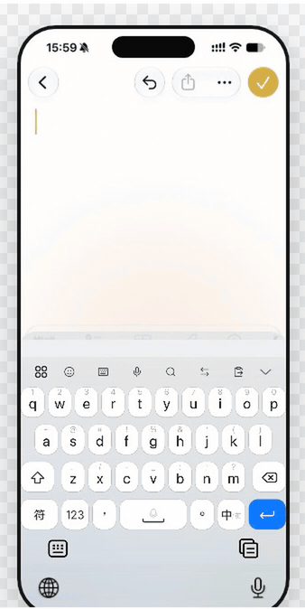

# 键设 KeySkin 官网

[键设 KeySkin](https://github.com/rekazer0/keyskin) 的官方网站：一款面向百度（BDI / BDS / BDA）、搜狗（SSF / MSSF）与手心（SXI）输入法皮肤的可视化编辑器。



## 页面内容

- 品牌视觉：像素风 Logo、深紫与荧光绿配色、橙黄色点缀，搭配奶油白背景与像素角色
- 首屏：产品介绍、在线使用与下载入口，配一幅静态渲染的编辑器工作区
- 功能演示：11 段可切换的操作演示（实时预览、交互预览、编辑按键、源码联动、资源工作区、拖动动画应用到按键、跨格式导出、ADB 推送、自定义工具栏、界面主题、移动端）；拖动动画、ADB 推送、自定义工具栏、选择界面主题可直接观看 GIF，其他场景以视频播放；每段都可下载 GIF，全部使用编辑器内置皮肤
- 功能详解、格式支持、更多能力、快速上手、下载与开源信息
- 自动适配浅色 / 深色与手机屏幕；开启“减少动态效果”时不自动播放

## 本地预览

纯静态站点，无需安装依赖：

```bash
npm run serve        # 等同于 python3 -m http.server 4173 --directory dist
npm test             # 检查文案、演示素材与页面引用的文件
```

浏览器打开 http://127.0.0.1:4173/。

## 重新录制功能演示

`dist/assets/demos/` 里的视频（`.mp4`）、动图（`.gif`）与封面（`.jpg`）都由脚本在键设网页版里真实操作后生成。

本批素材录自 KeySkin 2.0.0 工作区源码（提交 `5550344`）。录制只能从应用内置模板列表开始，不使用测试夹具或导入的皮肤；导出场景只展示导出过程，不重新打开生成的文件。ADB 场景录制真实界面，连接和推送结果由录制脚本模拟，不访问真机。

编辑器界面更新后可以重录：

```bash
git clone https://github.com/rekazer0/keyskin ../keyskin
(cd ../keyskin && npm ci)
KEYSKIN_DIR=../keyskin npm run record            # 全部场景
KEYSKIN_DIR=../keyskin npm run record -- typing  # 只录某一段
```

需要系统里有 `ffmpeg`。若 Playwright 找不到浏览器，用 `CHROMIUM_PATH` 指定 Chromium 路径。

## License

GPL-3.0
